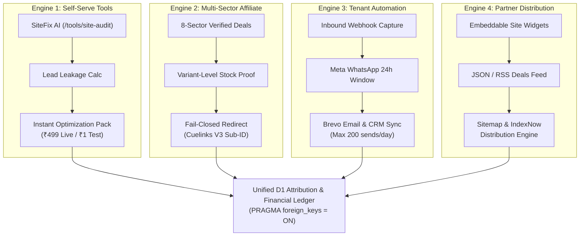

# GLOBAL AUTONOMY BRAIN — MULTI-SECTOR COMMERCIAL PLATFORM & OPERATING SYSTEM

**Single Source of Truth for Autonomous Operations, Commercial Architecture & Quota Ledgers**  
**Repository:** `harshavardhankotu/ai-marketing-organization`  
**Production URL:** `https://ai-marketing-organization.onrender.com`  
**Current State & Last Verified Commit:** `7e9010db7a727ee0b3f071cc84cb4ec11135859a` (PR #38 / V5.2)  
**Target Release:** V5.3 (Multi-Sector Autonomy, Brevo MCP, Google Indexing, Razorpay CSP Unblock)  

---

## 1. Mandatory Agent Operating Protocol
1. **Read First:** Every autonomous agent session MUST read this document (`GLOBAL_AUTONOMY_BRAIN.md`) before analyzing or altering any code or running commands.
2. **Token Discipline:** Do not perform broad exploratory repository scans. Open and modify only the specific files required for the assigned task.
3. **No Healthcare Drift:** This organization is NOT a dental clinic agency. Healthcare is merely 1 optional vertical in Sector 8 (Local Services & B2B Solutions). The platform is a **Multi-Sector Autonomous Commercial Engine** across 8 commercial sectors.
4. **Controlled High-Risk Modules Policy:** Agents MAY modify WhatsApp, Brevo, Google Indexing, GBP, Cuelinks, and Razorpay integrations provided:
   - All unit/integration tests pass before and after changes.
   - Free-tier hard caps and fail-closed guards remain intact.
   - Zero unsolicited spam, cold outreach auto-dispatch, or paid API overages occur.
5. **State Update:** Update the "Current State & Last Verified Commit" section of this document before completing any task.

---

## 2. The 8 Official Commercial Sectors

The platform operates across 8 authoritative commercial sectors, powered by empirical market data, live product availability, and verified merchant relationships:

| Sector Code | Sector Name | Description & Priority Focus | Monetization Channels |
| :--- | :--- | :--- | :--- |
| **SECTOR_1** | **Gold, Silver, Bullion & Jewellery** | Real-time spot rates (IBJA), digital gold platforms (MMTC-PAMP, SafeGold), bullion buying guides, hallmarked jewellery comparisons. | Cuelinks V3 affiliate offers, premium calculation tools, lead capture. |
| **SECTOR_2** | **Electronics & Technology** | Consumer electronics, headphones, audio, smartphones, wearables, computing hardware, accessories. | Direct brand affiliate campaigns (e.g. boAt Lifestyle), Cuelinks V3 redirects. |
| **SECTOR_3** | **Home & Appliances** | Smart home, kitchen appliances, water purifiers, air fryers, home automation. | Retailer affiliate programs, buying guides, price drops. |
| **SECTOR_4** | **Travel & Experiences** | Domestic flight bookings, hotel deals, holiday packages, luggage, travel tech. | OTA affiliate programs, itinerary generation tools. |
| **SECTOR_5** | **Software & Digital Services** | SaaS subscriptions, cloud hosting, developer tools, cybersecurity, AI software. | High-commission B2B SaaS affiliates, self-serve diagnostic tools. |
| **SECTOR_6** | **Office, Business & Industrial Equipment** | Commercial furniture, ergonomic seating, POS hardware, packaging materials, office tech. | B2B affiliate networks, lead capture for equipment vendors. |
| **SECTOR_7** | **Lifestyle & Consumer Goods** | Apparel, footwear, personal care, fitness equipment, nutritional supplements. | Direct-to-consumer affiliate links, seasonal product guides. |
| **SECTOR_8** | **Local Services & B2B Solutions** | Professional services, clinics, coaching academies, repair specialists, local SMBs. | SiteFix AI audits (₹499), 24/7 WhatsApp triage automation subscriptions (₹4,999/mo). |

---

## 3. The 4 Shared Monetization Engines

The platform unites 4 distinct, resilient monetization engines sharing a common Cloudflare D1 attribution ledger:



### Engine 1: Product-Led Self-Serve Tools
- **Offerings:** SiteFix AI (`/tools/site-audit`), Lead Leakage Calculator, Interactive Reception Demo.
- **Monetization:** Instant downloadable audit fix packs and implementation reports.
- **Pricing:** Authoritative server-side price of ₹499 (or ₹1 sandbox verification). Razorpay modal unblocked via CSP.
- **Asset Delivery:** Automated email delivery of audit report ZIP/PDF via Brevo transactional email within quota.

### Engine 2: Multi-Sector Affiliate Commerce
- **Offerings:** High-intent buying guides, price trackers, and in-stock deal cards across Sectors 1–8.
- **Monetization:** Provider-attributed commissions via Cuelinks V3 REST API (`subid=clickId, subid2=sector, subid3=dealId`).
- **Safety Gates:** 24h stock proof TTL; fail-closed redirects (`HTTP 503` if attribution logging fails; fallback to direct merchant URL if Cuelinks unreachable).
- **Separation:** Internal automated crons and health checks are recorded under `internalDiagnosticClicks` and NEVER inflate `externalOutboundClicks`.

### Engine 3: Multi-Tenant Business Automation
- **Offerings:** 24/7 Inbound inquiry triage, calendar slot reservation, after-hours receptionist replacement.
- **Monetization:** Monthly recurring subscriptions (₹4,999/mo Pilot, ₹9,999/mo Growth).
- **Channels:** Meta Cloud API WhatsApp (customer-initiated 24-hour reply window), Brevo transactional email, D1 inquiry logging.
- **Human Gate:** Outbound cold outreach is strictly prohibited from auto-dispatch (`human_approved = 0, dispatched = 0`). Only customer-initiated inquiries receive automated replies.

### Engine 4: Partner & Integration Distribution
- **Offerings:** Embeddable deal widgets, public JSON/RSS feeds (`/api/v1/public/feeds/deals.json`, `/rss.xml`), sitemaps (`/sitemap.xml`), and IndexNow syndication.
- **Monetization:** Extended reach, affiliate traffic syndication across third-party blogs, and SEO indexing.

---

## 4. API & Quota Ledger Rules

To guarantee ₹0 paid operational expenses and prevent provider bans, strict software-enforced rate and volume limits are mandatory:

### Brevo MCP Server & Transactional API (`BREVO_MCP_SERVER_API`)
- **Server Endpoint:** `https://mcp.brevo.com/v1/brevo/mcp`
- **Free-Plan Limits:** 300 emails/day, 50 open CRM deals, 2,000 automation contacts.
- **Platform Ledger Hard Cap:** **200 emails / UTC day** (preserves a 100-send safety margin).
- **Overflow Policy:** When daily count reaches 200, additional messages are queued in D1 with status `QUEUED_NEXT_UTC_WINDOW`. NEVER retry-loop against Brevo.
- **WhatsApp Block:** Sending WhatsApp messages through Brevo is **HARD-BLOCKED** (WhatsApp is not included in Brevo Free tier).

### Google Indexing API (`GOOGLE_INDEXING_API`)
- **Daily Quota:** 200 publish requests/day free tier.
- **Platform Ledger Hard Cap:** **180 requests / day** (preserves a 20-request safety margin).
- **Strict Schema Policy:** Google Indexing API calls (`URL_UPDATED`, `URL_DELETED`) are **ONLY** permitted for pages verified to contain valid `JobPosting` or `BroadcastEvent` (inside `VideoObject`) JSON-LD schema.
- **Ineligible Routing:** All other pages (SiteFix tools, buying guides, `/deals`) are rejected (`SKIPPED_INELIGIBLE_SCHEMA_TYPE`) and routed to the Sitemap + IndexNow + Search Console syndication pipeline.

### Search & Research APIs (Gemini & Tavily)
- **Tavily:** Capped by quota reservations; 7-day query result caching in `search_cache`.
- **Backlog Guard:** Prospect discovery jobs halt if pending unreviewed drafts exceed 25 items.

### Cuelinks V3 Scopes
- 4 verified scopes: Campaigns, Channels, Transactions, Clean URL redirection.
- Sub-ID tagging: `subid` (click UUID), `subid2` (commercial sector), `subid3` (offer/deal ID).

---

## 5. Security & Content-Security-Policy (CSP) Architecture

To support Razorpay Checkout without browser blocking (`"This content is blocked"`):
```http
Content-Security-Policy: default-src 'self'; script-src 'self' 'unsafe-inline' 'unsafe-eval' https://checkout.razorpay.com https://*.razorpay.com; frame-src 'self' https://api.razorpay.com https://checkout.razorpay.com https://*.razorpay.com; child-src 'self' https://api.razorpay.com https://checkout.razorpay.com https://*.razorpay.com; connect-src 'self' https://api.razorpay.com https://checkout.razorpay.com https://lumberjack.razorpay.com https://*.razorpay.com; img-src 'self' data: https: https://*.razorpay.com; style-src 'self' 'unsafe-inline'; font-src 'self' data:;
Cross-Origin-Embedder-Policy: unsafe-none
```

---

## 6. Financial Reality & Invariants

1. **Bank-Confirmed Cash:** Strictly ₹0.00 until bank statement credit verification.
2. **Paid Ad Budget:** Strictly ₹0.00.
3. **No Unbacked Claims:** All metrics displayed on owner digests must trace to verified database records or live external HTTP status checks.
4. **Foreign Key Integrity:** All SQLite and Cloudflare D1 tables require valid foreign key parent records (`PRAGMA foreign_keys = ON;`). Tests must seed parent organizations and businesses before inserting dependent records.
