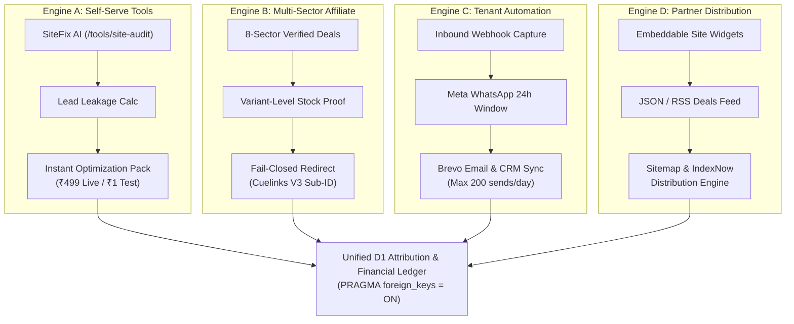

# GLOBAL AUTONOMY BRAIN — MULTI-SECTOR COMMERCIAL PLATFORM & OPERATING SYSTEM

**Single Source of Truth for Autonomous Operations, Commercial Architecture & Quota Ledgers**  
**Repository:** `harshavardhankotu/ai-marketing-organization`  
**Production URL:** `https://ai-marketing-organization.onrender.com`  
**Current State & Last Verified Commit:** `feat/v5-4-revenue-intelligence` (V5.4 Revenue Intelligence & Execution Engine)  
**Target Release:** V5.4 (Centralized Quota Ledger, Autonomous Policy Gate, Bayesian Sector Bandit, PageSpeed Insights)  

---

## 1. Mandatory Agent Operating Protocol
1. **Read First:** Every autonomous agent session MUST read this document (`GLOBAL_AUTONOMY_BRAIN.md`) before analyzing or altering any code or running commands.
2. **Token Discipline:** Do not perform broad exploratory repository scans. Open and modify only the specific files required for the assigned task.
3. **No Healthcare Drift:** This organization is NOT a dental clinic agency. Healthcare is merely 1 optional vertical in Sector H (Local Services & B2B Solutions). The platform is a **Multi-Sector Autonomous Commercial Engine** across 8 commercial sectors.
4. **Controlled High-Risk Modules Policy:** Agents MAY modify WhatsApp, Brevo, Google Indexing, GBP, Cuelinks, and Razorpay integrations provided:
   - All unit/integration tests pass before and after changes.
   - Free-tier hard caps and fail-closed guards remain intact.
   - Zero unsolicited spam, cold outreach auto-dispatch, or paid API overages occur.
5. **State Update:** Update the "Current State & Last Verified Commit" section of this document before completing any task.

---

## 2. Canonical Commercial Sector Taxonomy (Sectors A through H)

The platform operates across 8 authoritative commercial sectors, defined in `packages/shared/src/constants/sectors.ts`:

| Sector Code | Sector Name | Description & Priority Focus | Monetization Channels | Lifecycle Status |
| :--- | :--- | :--- | :--- | :--- |
| **SECTOR_A_PRECIOUS_METALS** | **Gold, Silver, Bullion & Jewellery** | Real-time spot rates (IBJA), digital gold platforms (MMTC-PAMP, SafeGold), bullion buying guides, hallmarked jewellery comparisons. | Cuelinks V3 affiliate offers, premium calculation tools, lead capture. | `ACTIVE` |
| **SECTOR_B_ELECTRONICS** | **Electronics & Technology** | Consumer electronics, headphones, audio, smartphones, wearables, computing hardware, accessories. | Direct brand affiliate campaigns (e.g. boAt Lifestyle), Cuelinks V3 redirects. | `LIVE_VERIFIED` |
| **SECTOR_C_HOME_APPLIANCES** | **Home & Appliances** | Smart home, kitchen appliances, water purifiers, air fryers, home automation. | Retailer affiliate programs, buying guides, price drops. | `ACTIVE` |
| **SECTOR_D_TRAVEL** | **Travel & Experiences** | Domestic flight bookings, hotel deals, holiday packages, luggage, travel tech. | OTA affiliate programs, itinerary generation tools. | `ACTIVE` |
| **SECTOR_E_SOFTWARE** | **Software & Digital Services** | SaaS subscriptions, cloud hosting, developer tools, cybersecurity, AI software. | High-commission B2B SaaS affiliates, self-serve diagnostic tools. | `ACTIVE` |
| **SECTOR_F_OFFICE_INDUSTRIAL** | **Office, Business & Industrial Equipment** | Commercial furniture, ergonomic seating, POS hardware, packaging materials, office tech. | B2B affiliate networks, lead capture for equipment vendors. | `ACTIVE` |
| **SECTOR_G_LIFESTYLE** | **Lifestyle & Consumer Goods** | Apparel, footwear, personal care, fitness equipment, nutritional supplements. | Direct-to-consumer affiliate links, seasonal product guides. | `ACTIVE` |
| **SECTOR_H_LOCAL_SERVICES_B2B** | **Local Services & B2B Solutions** | Professional services, clinics, coaching academies, repair specialists, local SMBs. | SiteFix AI audits (₹499), 24/7 WhatsApp triage automation subscriptions (₹4,999/mo). | `CONFIGURED` |

### Official Lifecycle Status Values
- `IMPLEMENTED`: Code, classes, and logic written and compiled cleanly.
- `CONFIGURED`: Environment variables, tokens, and endpoints wired.
- `AUTHORIZED`: Permitted under Autonomous Policy Gate or explicit owner sign-off.
- `LIVE_VERIFIED`: Probed and validated against live external production endpoints.
- `ACTIVE`: Actively executing in production background or scheduled cron.
- `DORMANT`: Ready to execute but currently idling or awaiting external trigger.
- `PARTIAL`: Partially functional; some sub-capabilities awaiting upstream provider response.
- `BLOCKED`: Blocked by quota limit, human review gate, or missing configuration.
- `FAILED`: Unsuccessful live probe or execution error.
- `NOT_IMPLEMENTED`: Specification draft without corresponding codebase implementation.
- `UNKNOWN`: Uninitialized or unmeasured state.

---

## 3. The 4 Interconnected Revenue Engines

The platform unites 4 distinct, resilient monetization engines sharing a common Cloudflare D1 attribution ledger:

### Engine A: Product-Led Self-Serve Tools
- **Offerings:** SiteFix AI (`/tools/site-audit`), Google PageSpeed Insights V5 bundle, Lead Leakage Calculator, Interactive Reception Demo.
- **Monetization:** Instant downloadable audit fix packs and implementation reports.
- **Pricing:** Authoritative server-side price of ₹499 (or ₹1 sandbox verification). Razorpay modal unblocked via CSP.
- **Asset Delivery:** Automated email delivery of audit report ZIP/PDF via Brevo transactional email within quota.

### Engine B: Multi-Sector Affiliate Commerce
- **Offerings:** High-intent buying guides, price trackers, and in-stock deal cards across Sectors A–H.
- **Monetization:** Provider-attributed commissions via Cuelinks V3 REST API (`subid=clickId, subid2=sector, subid3=dealId`).
- **Safety Gates:** 24h stock proof TTL; fail-closed redirects (`HTTP 503` if attribution logging fails; fallback to direct merchant URL if Cuelinks unreachable).
- **Separation:** Internal automated crons and health checks are recorded under `internalDiagnosticClicks` and NEVER inflate `externalOutboundClicks`.

### Engine C: Multi-Tenant Business Automation
- **Offerings:** 24/7 Inbound inquiry triage, calendar slot reservation, after-hours receptionist replacement.
- **Monetization:** Monthly recurring subscriptions (₹4,999/mo Pilot, ₹9,999/mo Growth).
- **Channels:** Meta Cloud API WhatsApp (customer-initiated 24-hour reply window), Brevo transactional email, D1 inquiry logging.
- **Human Gate:** Outbound cold outreach is strictly prohibited from auto-dispatch (`human_approved = 0, dispatched = 0`). Only customer-initiated inquiries receive automated replies.

### Engine D: Partner & Integration Distribution
- **Offerings:** Embeddable deal widgets, public JSON/RSS feeds (`/api/v1/public/feeds/deals.json`, `/rss.xml`), sitemaps (`/sitemap.xml`), and IndexNow syndication.
- **Monetization:** Extended reach, affiliate traffic syndication across third-party blogs, and SEO indexing.

---

## 4. Centralized Atomic D1 Quota Ledger (`provider_quota_ledger`)

To guarantee ₹0 paid operational expenses and prevent provider bans, all autonomous providers operate under software-enforced rate and volume limits persisted atomically in `provider_quota_ledger`:

| Provider | Window | Hard Limit | Operating Cap | Overflow / Exhaustion Action |
| :--- | :--- | :--- | :--- | :--- |
| `google_custom_search` | `PT_DAY` | 100/day | **60 / day** | Fallback to Tavily Search API |
| `tavily_search` | `UTC_MONTH` | 1,000/mo | **750 / mo (<= 20/day)** | Quota lock engaged; research paused |
| `google_indexing` | `PT_DAY` | 200/day | **180 / day** | Skipped; queued to sitemap/IndexNow |
| `brevo_mcp` | `UTC_DAY` | 300/day | **200 / day** | Queued with `QUEUED_NEXT_UTC_WINDOW` |
| `google_pagespeed` | `UTC_DAY` | 50/day | **40 / day** | Cached 24h fallback |
| `gemini_ai` | `UTC_DAY` | 1,500/day | **1,000 / day** | Rule-based deterministic fallback |
| `cuelinks_api` | `UTC_DAY` | 1,000/day | **500 / day** | Cached deal feed fallback |
| `razorpay_api` | `UTC_DAY` | 5,000/day | **1,000 / day** | Throttled backoff |

---

## 5. Autonomous Policy Gate (V5.4)

Implements strict segregation of autonomous execution vs human review:
- **Zero Fabricated Approvals:** The engine NEVER sets `human_approved = 1`.
- **Audit Lineage:** Every autonomous execution sets `approval_source = 'AUTONOMOUS_POLICY_GATE'`, `policy_id`, `policy_version`, `policy_evaluation_id`, `decision_timestamp`, `evidence_references`, `quota_reservation_id`.
- **Auto-Approved Whitelist:**
  1. Publishing verified, in-stock, affiliated deals from canonical sectors (Sectors A-G)
  2. Triggering PageSpeed / technical audits for consented / public business URLs
  3. Indexing submission for live canonical site routes (`JobPosting` / `BroadcastEvent` only)
  4. Content refresh / sitemap regeneration
  5. Exploration bandit model updates
- **Strictly Human-Gated Operations (Requires owner click at `/owner/today`):**
  1. Outbound B2B cold messaging / emails / WhatsApp dispatches to unconsented contacts
  2. Any financial spend or debit > ₹0.00
  3. Modifying statutory / legal disclosures / terms
  4. Contractual terms binding the company

---

## 6. Financial Reality & Invariants

1. **Bank-Confirmed Cash:** Strictly ₹0.00 until bank statement credit verification.
2. **Paid Ad Budget:** Strictly ₹0.00.
3. **No Unbacked Claims:** All metrics displayed on owner digests must trace to verified database records or live external HTTP status checks.
4. **Foreign Key Integrity:** All SQLite and Cloudflare D1 tables require valid foreign key parent records (`PRAGMA foreign_keys = ON;`). Tests must seed parent organizations and businesses before inserting dependent records.
