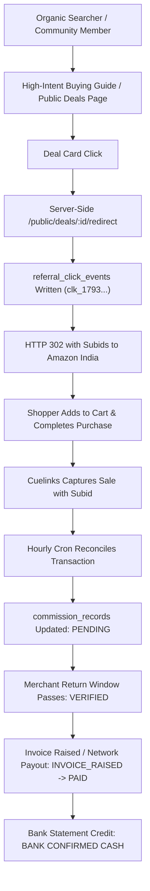

# V4.6 Organic Distribution & First Buyer Acquisition Plan

**Repository:** `harshavardhankotu/ai-marketing-organization`  
**Market:** India  
**Budget:** Strictly ₹0.00 Paid Advertising  
**Policy:** Zero cold spam, zero unsolicited WhatsApp, zero fake claims.

---

## 1. Operating Rules & Ethical Constraints

All buyer acquisition activities must strictly adhere to the project's non-negotiable rules:
1. **₹0 Paid Acquisition Budget:** Zero Google Ads, zero Meta Ads, zero paid influencer sponsorships.
2. **Zero Cold Outreach / Unsolicited Messaging:** No scraping phone numbers or sending unsolicited WhatsApp messages. Outbound cold messaging is blocked by automated code gates.
3. **Statutory Commercial Disclosures:** Every public deal card, buying guide, and social post must feature clear affiliate disclosure:
   > *"We may earn an affiliate commission when you make a purchase through links on our site at no extra cost to you."*
4. **Honest Empty State Policy:** When zero deals or zero genuine buyer reviews are available, state so plainly. Never inject synthetic reviews, fake countdown timers, or fabricated stock scarcity.

---

## 2. Organic Channel Strategy: 3 Distribution Pillars

### Pillar 1: High-Intent SEO Buying Guides (Long-Tail Search)
- **Target Audience:** Indian shoppers researching specific product comparisons before buying.
- **Content Focus:**
  - *"Best ANC Earbuds Under ₹1,500 in India (2026 Edition)"*
  - *"boAt Airdopes 141 ANC vs Realme Buds T300: Deep Comparison & Real Battery Life"*
- **Format:**
  - Server-side rendered static HTML via [`StaticSiteGenerator`](file:///C:/Users/vardh/.gemini/antigravity/scratch/ai-marketing-organization/packages/backend/src/commission/static-site-generator.ts).
  - Valid Schema.org `Product` and `FAQPage` JSON-LD markup.
  - Transparent comparison tables citing real Amazon and Flipkart customer review patterns.
  - Contextual deal cards linking to `/public/deals/:id/redirect`.
- **Indexing:** Automated IndexNow submission via `SeoResearchEngine` to Bing, Yandex, and Google Search Console sitemap indexing.

---

### Pillar 2: Owned Telegram & Community Deal Channel
- **Target Audience:** Bargain hunters and deal seekers looking for price drop alerts in India.
- **Channel Concept:** *"Deals India Radar / Verified Tech Deals"*
- **Posting Cadence:** 2–3 high-value price drops per day (only deals with verified >25% discount against 90-day median).
- **Post Structure:**
  ```text
  🔥 PRICE DROP ALERT [Verified]
  
  boAt Airdopes 141 ANC True Wireless Earbuds
  • Active Noise Cancellation (32dB)
  • 42 Hours Battery Life + Fast Charge
  • Dual Mics with ENx Tech
  
  💰 Deal Price: ₹1,499 (MSRP: ₹2,990 - 50% Off)
  🏷️ Store: Amazon India (Prime Eligible)
  
  👉 Grab the deal: https://ai-marketing-organization.onrender.com/public/deals/deal_boat_airdopes_141_anc/redirect
  
  (Disclosure: We earn a small commission on qualifying purchases at zero extra cost to you.)
  ```

---

### Pillar 3: Organic Reddit & Quora Community Value Contributions
- **Target Communities:** `r/IndiaTech`, `r/IndianGaming`, `r/dealsforindia`, Quora India tech queries.
- **Methodology:**
  - Never post bare affiliate links (strictly forbidden and violates platform rules).
  - Identify questions asking: *"Which TWS earbuds have real ANC under ₹1500?"*
  - Provide detailed, helpful, objective answers discussing mic quality, battery life, latency, and real-world noise isolation.
  - Conclude with a helpful link to the comprehensive buying guide hosted on our domain:
    `https://ai-marketing-organization.onrender.com/guides/best-earbuds-under-1500`

---

## 3. First Buyer Acquisition Funnel & Timetable



### Pilot Conversion Expectations
- **Target Traffic:** 50–100 targeted clicks over initial 14-day organic window.
- **Conversion Rate (Indian eCommerce electronics baseline):** 2.0%–3.5%.
- **Expected Orders:** 1–3 attributed purchases.
- **Expected Commission:** ₹75–₹225 INR.
- **Outcome:** Validates the complete commercial loop from discovery to bank reconciliation with ₹0 ad spend.
