# V4.6 First Revenue Operating Report: 15-Stage Unified Funnel & Commercial Status

**Repository:** `harshavardhankotu/ai-marketing-organization`  
**Date:** November 2026  
**Operating Baseline:** Strict Financial Truth (₹0.00 Bank-Confirmed Cash, ₹0.00 Paid Advertising)  
**Production URL:** `https://ai-marketing-organization.onrender.com`  
**Render Service ID:** `srv-darecoc9v7es73ea8t2g`

---

## 1. The 15-Stage Unified Commercial Funnel

To ensure complete clarity and eliminate confusion between potential deals, raw clicks, receivable invoices, and actual cash in the bank, the platform operates on a 15-stage unified commercial lifecycle.

```mermaid
flowchart LR
    S1[1. Merchant Discovered] --> S2[2. Campaign Approved]
    S2 --> S3[3. Offer Ingested]
    S3 --> S4[4. Deal Verified]
    S4 --> S5[5. Affiliate Link Generated]
    S5 --> S6[6. Published Online]
    S6 --> S7[7. Visitor Arrived]
    S7 --> S8[8. Deal Click Recorded]
    S8 --> S9[9. Merchant Redirected]
    S9 --> S10[10. Order Placed]
    S10 --> S11[11. Conversion Reported]
    S11 --> S12[12. Commission Validated]
    S12 --> S13[13. Invoice Raised]
    S13 --> S14[14. Payout Disbursed]
    S14 --> S15[15. Bank Cash Confirmed]
```

### Forensic Status of All 15 Stages:

| Stage # | Stage Name | Technical Status | Empirical Evidence Source | Current Production Count |
|---|---|---|---|---|
| 1 | **Merchant Discovered** | ACTIVE | `deal_sources` table in D1 | 8 active sources (Amazon, Flipkart, Tanishq, Myntra, etc.) |
| 2 | **Campaign Approved** | ACTIVE | `partners` & Cuelinks search API | Verified approval on open access campaigns |
| 3 | **Offer Ingested** | ACTIVE | `deals` table & D1 workflows | Curated live deal candidates in catalog |
| 4 | **Deal Verified** | ACTIVE | `AutonomousDealDiscoveryEngine` | Price cross-check, freshness <48h |
| 5 | **Affiliate Link Generated** | ACTIVE | `linkRegistry` & Cuelinks V3 `convertLink` | Verified `affiliated === true` and safe tracking URL |
| 6 | **Published Online** | ACTIVE | Public Deals Page (`/deals`) & Static Guides | Server-rendered deal cards with disclosures |
| 7 | **Visitor Arrived** | ACTIVE | `referral_click_events` & server access logs | Organic visitors arriving on public pages |
| 8 | **Deal Click Recorded** | ACTIVE | `referral_click_events` | Immutable click record with `click_id` |
| 9 | **Merchant Redirected** | ACTIVE | `/public/deals/:id/redirect` (HTTP 302) | Dynamic 5-level hierarchical sub-IDs attached |
| 10 | **Order Placed** | AWAITING BUYER | Upstream Merchant Checkout | Real Indian shopper completing transaction |
| 11 | **Conversion Reported** | AWAITING PROVIDER | Cuelinks `/transactions` (status: pending) | Attributable order recorded with `subid = clickId` |
| 12 | **Commission Validated** | AWAITING MATURITY | Cuelinks `/transactions` (status: approved) | 30-day merchant return window completion |
| 13 | **Invoice Raised** | AWAITING CYCLE | Cuelinks `/transactions` (status: invoice_raised) | Network invoice generated (receivable asset) |
| 14 | **Payout Disbursed** | AWAITING SETTLEMENT | Cuelinks payment disbursement report | Network NEFT/RTGS disbursement initiation |
| 15 | **Bank Cash Confirmed** | STRICT ZERO (₹0.00) | Official Bank Statement Credit | **₹0.00 until bank statement credit verification** |

---

## 2. Strict Financial Truth & Balance Sheet Reality

In strict compliance with project invariants:
- **Bank-Confirmed Cash:** **₹0.00**
- **Paid Acquisition Spend:** **₹0.00**
- **Reported Conversions:** **0**
- **Pending Commissions:** **₹0.00**
- **Validated Commissions:** **₹0.00**
- **Paid Commissions:** **₹0.00**

> [!IMPORTANT]
> Non-Negotiable Rule: Zero synthetic transactions, zero estimated cash recognition, zero simulated revenue. Bank cash remains strictly ₹0.00 until official bank statement verification with UTR reference.

---

## 3. Sprint V4.6 Phase Status & Verification Matrix

| Phase | Description | Status | Verification Summary |
|---|---|---|---|
| **Phase 1** | Version & Workspace Reconciliation | COMPLETED | Verified `feat/v4-2-multi-sector-commerce-recovery` contains complete V4.1, V4.2, V4.4, V4.5 codebase based on PR #33 tip (`bc214b3`). Authored `docs/v4-6-version-reconciliation.md`. |
| **Phase 2** | Durable Queue, Fast Ping & Lease Fencing | COMPLETED | Migration `0045_automation_job_lease_fencing.sql`. Implemented lease token fencing in `DurableJobQueue`, batch enqueue (`enqueueJobsBatch`) reducing ping latency from 1.8s to 18ms, and bounded worker drain loop (`budgetMs=20000&maxJobs=3`). |
| **Phase 3** | Business Logic & False Success Repair | COMPLETED | Repaired `competitor_pricing_research` (fresh benchmark gating), `prospect_discovery_validation` (empirical count), `prospect_dedup_qualification` (canonical identity normalization & deduplication), `payment_status_reconciliation` (returns BLOCKED on unverified claims, preserving ₹0 cash). Authored `docs/v4-6-business-logic-audit.md`. |
| **Phase 4** | Cuelinks Pipeline Consolidation | COMPLETED | Eliminated duplicated Cuelinks API calls. Added `options.skipOfferFetch` and `syncReconciliationOnly()` to `CuelinksSyncManager`. Idempotent link conversion registry in `AutonomousDealDiscoveryEngine`. Authored `docs/v4-6-cuelinks-and-attribution-repair.md`. |
| **Phase 5** | First Commerce Pilot Selection | COMPLETED | Selected boAt Airdopes 141 ANC on Amazon India with 50% discount (₹1,499) and active Cuelinks tracking. Authored `docs/v4-6-first-commerce-pilot.md`. |
| **Phase 6** | End-to-End Attribution & Sub-ID Repair | COMPLETED | Implemented dynamic subid replacement (`subid=clickId`) in `buildProviderDestinationUrl` and `/public/deals/:id/redirect`. Eliminates static offer-level subid overwrite. |
| **Phase 7** | Owner Control & Financial Truth | COMPLETED | Owner control center enforces zero unbacked claims, displays exact 16-metric sector breakdown, and flags unverified manual UPI claims as BLOCKED. |
| **Phase 8** | Multi-Sector Engine Expansion | COMPLETED | 8 distinct commercial sectors defined and active in taxonomy with Sector A (Precious Metals) and Sector B (Consumer Tech) prioritized. |
| **Phase 9** | Organic Distribution & Buyer Acquisition | COMPLETED | Established 3-pillar zero-budget distribution strategy (SEO Buying Guides, Community Channels, Tech Forums). Authored `docs/v4-6-distribution-and-acquisition-plan.md`. |
| **Phase 10** | Pre-Holiday & Seasonal Demand Alignment | COMPLETED | Seasonal demand calendar active with Diwali and Black Friday deal opportunity matchers. |
| **Phase 11** | Regression Tests & Automated Verification | COMPLETED | Created `v4-6-business-logic-and-queue-repair.test.ts` (11/11 tests pass). All 40 unit tests across V4.1, V4.2, and V4.6 pass. Typecheck clean across all 4 workspaces. Preflight and linters pass. |

---

## 4. Operational Next Steps for the Platform Owner

1. **Verify Live Render Environment Variables:**
   - Confirm `CUELINKS_API_KEY` is active on Render service `srv-darecoc9v7es73ea8t2g`.
   - Confirm Cloudflare Worker cron trigger is actively pinging `/api/v1/cron/ping`.
2. **Review Pending Approvals at `/owner/today`:**
   - Inspect newly generated compliant direct communication drafts and research findings.
   - When manual UPI claims are submitted, verify against actual bank account statement before approving.
3. **Deploy Organic Content:**
   - Review and publish the generated buying guides for the first commerce pilot (boAt Airdopes 141 ANC).
   - Share the pilot deal card on owned Telegram and community channels.
