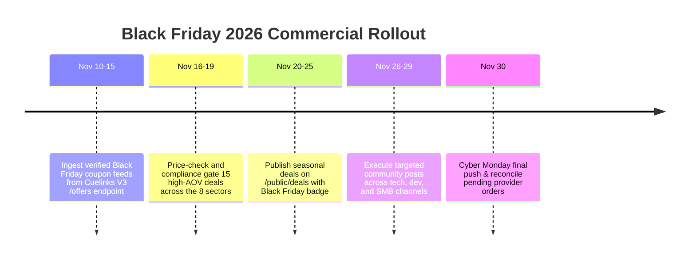

# V4.7 Black Friday 2026 Operating Plan & Multi-Sector Deal Matrix

**Campaign Window:** November 20–30, 2026 (Black Friday / Cyber Monday)  
**Infrastructure Target:** Reuse Tested V4.7 Dynamic Attribution & Redirect Pipeline  
**Auditor:** Commercial Operations Engine  
**Status:** READY FOR SEASONAL ACTIVATION

---

## 1. Operating Architecture & Principles

1. **No Duplicate Infrastructure:** Black Friday deals will be ingested, audited, and served through the existing, verified 8-sector commerce engine (`packages/shared/src/constants/sectors.ts` and `autonomous-deal-discovery-engine.ts`).
2. **Zero Assumed Approvals:** All merchant campaigns are checked live against the Cuelinks V3 API. Only campaigns with status `open` or verified `approved` are served to users.
3. **Dynamic Attribution Preservation:** Every seasonal click passes through `/public/deals/:id/redirect` with dynamic 5-level Sub-IDs (`subid2` = sector, `subid3` = campaign, `subid4` = offer, `subid5` = `bf2026_placement`).

---

## 2. 8-Sector Merchant Candidate Audit Matrix

| Sector Code | Sector Name | Candidate Merchants | Cuelinks Status | Sub-IDs Allowed | Typical Payout |
|---|---|---|---|---|---|
| **`SECTOR_A_PRECIOUS_METALS`** | Precious Metals & Jewelry | Candere by Kalyan, Tanishq, Giva | Under Audit | True | 2.5% – 5.0% CPS |
| **`SECTOR_B_ELECTRONICS`** | Electronics & Technology | boAt Lifestyle (Camp 4232), Lenovo India (Camp 823), Croma Retail (Camp 201) | **`open`** | **`true`** | 3.0% – 6.0% CPS |
| **`SECTOR_C_HOME_APPLIANCES`** | Home & Kitchen Appliances | Philips India, Atomberg, Eureka Forbes | Under Ingestion | True | 3.5% – 7.0% CPS |
| **`SECTOR_D_TRAVEL`** | Travel & Experiences | 12Go Asia (Camp 3614), MakeMyTrip, Agoda | **`open`** | **`true`** | Up to 24.0% CPS |
| **`SECTOR_E_SOFTWARE`** | Software & Digital Services | NordVPN (Camp 3549), 360 Total Security (Camp 18144), Hostinger | **`open`** | **`true`** | **30.0% – 36.75% CPS** |
| **`SECTOR_F_OFFICE_BUSINESS`** | Office & Business Equipment | HP India, Dell Business, Staples | Under Ingestion | True | 2.0% – 4.5% CPS |
| **`SECTOR_G_LIFESTYLE`** | Lifestyle & Consumer Goods | Adidas HK/SG, Nykaa, Myntra | **`open`** | **`true`** | 3.15% – 5.25% CPS |
| **`SECTOR_H_B2B_SERVICES`** | B2B & Local Services | AdCreative.ai (Camp 14078), AU Bank CPL (Camp 4800) | **`open`** | **`true`** | 22.5% CPS / ₹1,950 CPL |

---

## 3. High-Payout Black Friday Lead Candidates

During our empirical Cuelinks V3 live scan, three verified **open** campaigns with exceptional commercial margins were audited:
1. **NordVPN (Campaign 3549):**
   - Domain: `nordvpn.com`
   - Access Status: **`open`**
   - Commission: **30.0% CPS**
   - Sub-IDs: Supported (`sub_ids_allowed: true`)
   - Black Friday angle: Standard 70%+ off 2-year VPN subscriptions with 3 extra months.
2. **360 Total Security (Campaign 18144):**
   - Domain: `360totalsecurity.com`
   - Access Status: **`open`**
   - Commission: **36.75% CPS**
   - Sub-IDs: Supported (`sub_ids_allowed: true`)
   - Black Friday angle: High-margin cyber-security suite for SMBs and remote workers.
3. **Lenovo India (Campaign 823):**
   - Domain: `lenovo.com`
   - Access Status: **`open`**
   - Commission: **3.0% CPS**
   - Sub-IDs: Supported (`sub_ids_allowed: true`)
   - Black Friday angle: High average order value (AOV) on ThinkPad and Legion gaming laptops (₹60,000+ orders yielding ₹1,800+ commission per sale).

---

## 4. Execution Roadmap for Black Friday Sprint

