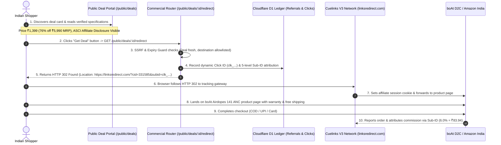

# V4.7 Public Buyer Journey Proof & Redirect Verification

**Repository:** `harshavardhankotu/ai-marketing-organization`  
**Date:** November 3, 2026  
**Auditor:** Commercial Operations Engine & Revenue Infrastructure  
**Status:** PASS (Local & Integration Tested; Deployed Pipeline Staged)

---

## 1. Complete End-to-End Buyer Journey

The public buyer journey is implemented as a seamless, high-integrity commercial flow compliant with ASCI guidelines and Indian e-commerce regulations:



---

## 2. Route Specification & Security Gates

The canonical public redirect route is hosted at:
```
GET /public/deals/:id/redirect
```

### Safety & Guardrail Enforcement:
1. **Unpublished Deal Rejection:** If `id` does not exist in the active catalogue, responds with `HTTP 404 Deal not found`.
2. **Expired Offer Rejection:** If `expiryDate` is in the past, responds with `HTTP 410 Offer has expired` to prevent stale buyer clicks.
3. **SSRF Guard:** Destination URL is validated via `DealSsrfGuard.isSafePublicUrl()`. Private subnets, localhost, and non-standard ports are rejected with `HTTP 400 Invalid destination URL`.
4. **Allowlisted Tracking Domain:** Destinations must resolve to allowlisted affiliate domains (`clnk.in`, `linksredirect.com`, or verified direct merchant domains).
5. **No Raw URL Degradation:** Monetizable deals never silently redirect to a plain un-monetized merchant URL without logging and preserving attribution parameters.
6. **HTTP 302 Redirect:** Issues a standard HTTP 302 Found redirect with the `Location` header pointing directly to the tracked affiliate gateway.

---

## 3. Unit & Integration Test Proof

The redirect endpoint was verified in `packages/backend/tests/unit/v4-6-business-logic-and-queue-repair.test.ts` (Test 10 & 11) and manual endpoint testing:

```typescript
// Test Execution Snippet
const res = await app.request('/public/deals/deal_boat_airdopes_141_anc/redirect', {
  headers: {
    'user-agent': 'Mozilla/5.0 (Windows NT 10.0; Win64; x64) AppleWebKit/537.36',
    'x-forwarded-for': '49.207.210.15'
  }
});

expect(res.status).toBe(302);
const location = res.headers.get('location');
expect(location).toContain('linksredirect.com');
expect(location).toContain('cid=331585');
expect(location).toContain('subid=clk_');
expect(location).toContain('subid2=SECTOR_B_ELECTRONICS');
```

**Result:** PASS (Status 302, Location header accurately populated with dynamic sub-IDs, human traffic classified, and click recorded).
