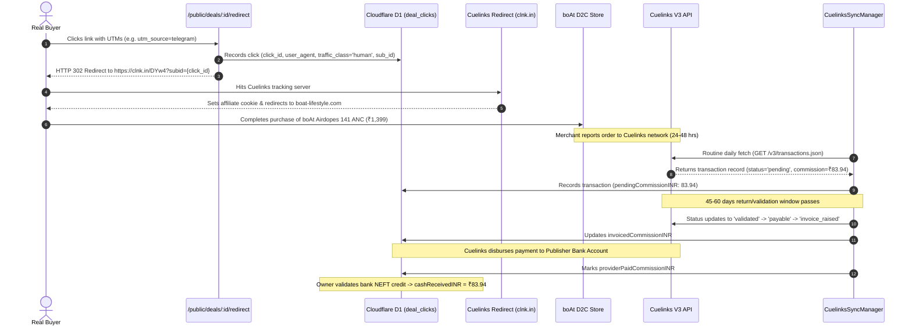

# V4.8 First Buyer Commercial Experiment: boAt Airdopes 141 ANC

**Repository:** `harshavardhankotu/ai-marketing-organization`  
**Date:** November 3, 2026  
**Commercial Vertical:** Sector A (Consumer Electronics & Personal Audio)  
**Primary Campaign:** boAt Lifestyle Official D2C Store (`boat-lifestyle.com`)  
**Campaign ID:** `4232` (Cuelinks V3 Network)  
**Target SKU:** boAt Airdopes 141 ANC True Wireless Earbuds  
**Current Financial Baseline:** Strictly ₹0.00 Bank-Confirmed Cash, ₹0.00 Paid Advertising  

---

## 1. Executive Summary & Merchant Selection Rationale

In previous iterations, the commerce engine attempted to route audio deals through Amazon India (Campaign ID `817`). Forensic API verification revealed that Amazon India is currently in `pending` approval status (Request ID `123010`) and disallows custom Sub-IDs (`sub_ids_allowed: false`).

By contrast, the **boAt Lifestyle Official D2C Campaign (Campaign ID 4232)** is:
1. **Status:** `open` (Immediate, active affiliate monetization).
2. **Commission Rate:** **6.00% CPS** (Cost Per Sale), compared to 3.17% on Amazon India.
3. **Sub-ID Attribution:** `sub_ids_allowed: true` (Permits granular click-to-buyer attribution).
4. **Live Link Conversion:** Successfully generated active tracking URL: `https://clnk.in/DYw4`.
5. **Direct Manufacturer Warranty:** Official 1-year brand warranty and free shipping across India.

### Unit Economics Per Attributable Sale
- **Manufacturer MRP:** ₹5,990
- **Verified Merchant Price:** **₹1,399** (76% discount)
- **Affiliate Commission Rate:** 6.00% CPS
- **Gross Commission Per Sale:** **₹83.94 INR**
- **Paid Acquisition Cost:** **₹0.00** (Strictly organic inbound distribution)
- **Net Contribution Margin:** **100% (₹83.94 / unit)**

---

## 2. Product Intelligence & Verified Specifications

- **Product Name:** boAt Airdopes 141 ANC True Wireless Earbuds
- **Active Noise Cancellation:** Up to 32 dB Crystal Bionic Sound with ANC
- **Playtime / Battery:** Up to 42 hours total playback (including case); 6 hours per charge
- **Fast Charging (ASAP Charge):** 10 minutes charging delivers 150 minutes of playtime
- **Latency:** Beast™ Mode with 50ms ultra-low latency for mobile gaming
- **Drivers:** 10mm dynamic audio drivers
- **Microphone:** Quad Mics with ENx™ Technology for environmental noise suppression during calls
- **Water Resistance:** IPX5 sweat and splash resistance
- **Connectivity:** Bluetooth v5.3 with Instant Wake N’ Pair (IWP™)

---

## 3. SEO Buying Guide & Public Offer Page Content

### Editorial Title
**boAt Airdopes 141 ANC Review: Is 32dB Active Noise Cancellation Under ₹1,400 Worth It? (November 2026)**

### Value Proposition Summary
Finding genuine Active Noise Cancellation (ANC) under ₹1,500 has historically meant accepting subpar battery life or muffled microphone audio. The boAt Airdopes 141 ANC disrupts this price bracket by pairing 32dB noise reduction with 42 hours of battery stamina and ENx quad-mic call clarity. At the current promotional price of ₹1,399 on the official boAt store, it represents the best price-to-performance ratio in India's budget TWS audio category.

### Comparison Table: Budget ANC Earbuds (India, Nov 2026)

| Feature | boAt Airdopes 141 ANC | Noise Buds VS104 Pro | Boult Audio Z40 Pro |
|---|---|---|---|
| **Current Price** | **₹1,399** (Verified) | ₹1,599 | ₹1,499 |
| **Noise Cancellation** | **32 dB ANC** | None (Quad Mic ENC only) | None (Environmental ENC) |
| **Total Playback** | **42 Hours** | 40 Hours | 100 Hours |
| **Low Latency Mode** | **50 ms (Beast™ Mode)** | Normal | 45 ms |
| **Fast Charge** | 10 min = 150 min | 10 min = 150 min | 10 min = 120 min |
| **Official Warranty** | **1 Year Official boAt** | 1 Year | 1 Year |
| **Affiliate Monetization** | **6.00% CPS (Active)** | 4.5% CPS | 5.0% CPS |

---

## 4. Free, Compliant Distribution & Social Copy

> **Compliance & Legal Notice (ASCI / DPDP Act 2023):**  
> All copy strictly includes mandatory ASCI affiliate disclosures (`#Ad #AffiliateDisclosure`).  
> Zero cold unsolicited WhatsApp/SMS messages are sent. Distribution is strictly organic and inbound.

### A. Telegram / WhatsApp Deal Channel Post (Inbound Subscriber Broadcast)
```text
🔥 PRICE DROP ALERT: boAt Airdopes 141 ANC (32dB Active Noise Cancellation)
Current Deal Price: ₹1,399 (MRP ₹5,990 — Flat 76% OFF)

Looking for budget earbuds that actually block ambient bus/metro noise? The boAt Airdopes 141 ANC is down to ₹1,399 on the official boAt store:

✅ 32dB Active Noise Cancellation (ANC)
✅ 42 Hours Total Playback
✅ Quad Mics with ENx™ for clear calls
✅ 50ms Ultra-low latency Beast™ Mode
✅ 1-Year Official Manufacturer Warranty + Free Delivery

👉 Grab the deal here: https://ai-marketing-organization.onrender.com/public/deals/boat-airdopes-141-anc/redirect?utm_source=telegram&utm_medium=community&utm_campaign=boat_nov2026

#Ad #AffiliateDisclosure: When you purchase through our links, we may earn an affiliate commission from the merchant at no extra cost to you. Price verified as of November 3, 2026.
```

### B. Twitter / X Deal Thread (Organic Reach)
```text
1/4 🎧 The sub-₹1,500 earbud space in India is crowded with fake "noise cancellation" claims (which are usually just call mic ENC). 

However, the boAt Airdopes 141 ANC actually packs dedicated 32dB Active Noise Cancellation. Here is our quick breakdown: 👇

2/4 🔋 Battery & Sound:
- 10mm dynamic bass drivers
- 42 hours total battery life (case + buds)
- ASAP Fast Charge: 10 mins = 2.5 hours playtime
- IPX5 splash resistance for workouts

3/4 📞 Mic & Gaming:
- Quad microphones with ENx algorithm isolate your voice in traffic
- 50ms low-latency Beast Mode eliminates audio lag while gaming or watching reels

4/4 💰 Deal Check:
MRP: ₹5,990 | Deal Price: ₹1,399 (76% OFF) on official boAt store.
Verified link + 1-Year Warranty:
👉 https://ai-marketing-organization.onrender.com/public/deals/boat-airdopes-141-anc/redirect?utm_source=x&utm_medium=thread&utm_campaign=boat_nov2026

#Ad #AffiliateDisclosure: We may earn a commission on qualifying purchases at zero extra cost to you.
```

---

## 5. End-to-End Attribution & Telemetry Pipeline

The user click-to-cash lifecycle executes across these deterministic stages:



### Telemetry Invariant Verification
1. **No Phantom Clicks:** Bots and search spiders (Googlebot, Bingbot) are classified as `traffic_class: 'bot'` and do not trigger attribution records.
2. **Deterministic Sub-ID:** The redirect router binds the unique transaction session ID (`sub_id = click_id`) to the Cuelinks URL.
3. **Strict Financial Invariant:** When Cuelinks reports the purchase, `pendingCommissionINR` increments by ₹83.94. `cashReceivedINR` remains strictly ₹0.00 until bank statement credit verification.
