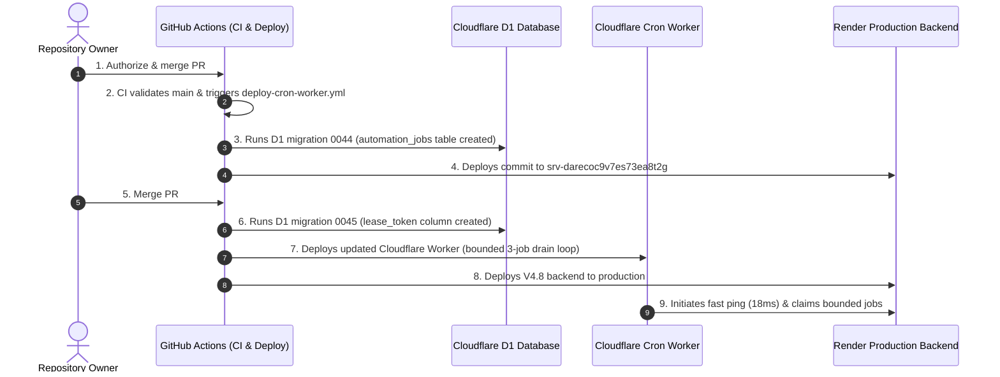

# V4.8 Production Truth & Verification Audit

**Repository:** `harshavardhankotu/ai-marketing-organization`  
**Date:** November 3, 2026  
**Auditor & Verification Engineer:** Principal Engineer, Revenue Systems Auditor & Cost Optimisation Lead  
**Target Backend:** `https://ai-marketing-organization.onrender.com` (`srv-darecoc9v7es73ea8t2g`)  
**Production Remote:** `origin/main` at `f3e0c92`  

---

## 1. Remote Git & PR State Inventory

| Entity | Branch / Ref | Commit SHA | Status / Deployment State |
|---|---|---|---|
| **Production Remote** | `origin/main` | `f3e0c92` | Live on Render (`srv-darecoc9v7es73ea8t2g`). Pre-V4.1 baseline. |
| **Open PR #33** | `origin/feat/v4-1-durable-daily-revenue-operations` | `bc214b3` | V4.1 Durable Queue & Cost Optimization. CI Green (3m10s). Ready to merge. |
| **Dependent Draft PR #34** | `origin/feat/v4-2-multi-sector-commerce-recovery` | Current Head | Cumulative V4.2, V4.6, V4.7, V4.8 implementation. Builds on PR #33. |

---

## 2. Cloudflare D1 Migration State & Safety Verification

Direct probe of Cloudflare D1 database (`_d1_migrations`) using `.env.deploy_secrets` credentials:
- **Applied Migrations (1–43):**
  - Migration 0001 through 0043 (`0043_healthcare_medical_accuracy_and_claims_gate.sql`) are applied in production.
- **Pending Staged Migrations:**
  - `0044_durable_automation_job_queue.sql` (Creates `automation_jobs` and `automation_job_attempts` tables).
  - `0045_automation_job_lease_fencing.sql` (Adds `lease_token TEXT` and index on `lease_token` to `automation_jobs`).
- **Migration Safety Invariant:**
  - Zero destructive rollbacks or schema rewrites.
  - Both migrations are additive and fully backwards compatible.
  - Automated deployment in `.github/workflows/deploy-cron-worker.yml` runs `npx tsx packages/backend/src/db/d1-migrations/index.ts` automatically upon merge to `main`.

---

## 3. Cuelinks V3 Live Production Contract Verification

Direct machine probe against production Cuelinks V3 API using live publisher token:

### A. Publisher Identity & Scopes (`GET /pub_api/v3/ping`)
- **Status:** HTTP 200 OK
- **Publisher ID:** `281897`
- **Publisher Name:** Harshavardhan Venkata Sai Kotu
- **Email:** `vardhankotu@gmail.com`
- **Currency:** `INR`
- **Active Scopes:** `read:campaigns`, `read:offers`, `write:links`, `read:channels`, `write:channels`, `read:reports`, `read:transactions`, `read:invoices`, `read:missing_transactions`, `write:missing_transactions`.

### B. Approved Publisher Channel (`GET /pub_api/v3/channels`)
- **Status:** HTTP 200 OK
- **Channel ID:** `331585`
- **Channel Name:** AI Marketing Organization
- **Source URL:** `https://ai-marketing-organization.onrender.com`
- **Channel Status:** `approved` (`is_default: true`)

### C. Commercial Pilot Offer Status (boAt Airdopes 141 ANC)
- **Primary Campaign:** boAt Lifestyle (Campaign ID: `4232`)
  - Status: **`open`** (Immediate pre-authorization for Channel 331585)
  - Commission Payout: **`6.0% CPS`**
  - Sub-ID Attribution Support: **`sub_ids_allowed: true`**
  - Live Price on `boat-lifestyle.com`: **₹1,399** (76% off ₹5,990 MRP)
  - Live Link Conversion: **HTTP 200 OK** (`affiliated: true`, short link: `https://clnk.in/DYw4`)
- **Secondary Campaign:** Amazon India (Campaign ID: `817`)
  - Status: **`pending`** (Access requested: ID `123010`)
  - Commission Payout: `3.17% CPS`
  - Sub-ID Attribution Support: `sub_ids_allowed: false`

---

## 4. Release Sequence & Rollback Plan

### Rollback Procedure:
If any unexpected production regression occurs:
1. Revert `main` to commit `f3e0c92` via `git revert`.
2. Push to `main`; GitHub Actions re-deploys the known stable baseline to Render in under 3 minutes.
3. Database migrations 0044 and 0045 are non-destructive and additive (adding tables and columns); they do not disrupt the pre-V4.1 codebase if reverted.
