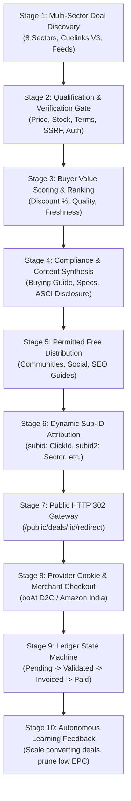

# V4.8 End-to-End Autonomous Revenue Loop Architecture

**Repository:** `harshavardhankotu/ai-marketing-organization`  
**Date:** November 3, 2026  
**Auditor & Lead Architect:** Principal Engineer, Revenue Systems Auditor & Cost Optimisation Lead  
**Target:** Autonomous, Provider-Attributed Affiliate & Commerce Revenue  

---

## 1. Architectural Overview & The 10-Stage Commercial Lifecycle

The AI Marketing Organization operates as a closed-loop commercial system designed to discover, qualify, monetize, distribute, attribute, and reconcile commercial opportunities without human routine intervention:



---

## 2. Detailed Stage Specifications

### Stage 1: Multi-Sector Opportunity Discovery
- Ingests candidates across the canonical 8 sectors (Precious Metals, Electronics, Home Appliances, Travel, Software, Office Equipment, Lifestyle, Local Services B2B).
- Integrates with Cuelinks V3 Monetization API (`GET /pub_api/v3/campaigns`, `GET /pub_api/v3/offers`) using resumable cursor pagination (`campaignPage`, `offerPage`).

### Stage 2: Qualification & Verification Gate
- Requires live merchant price verification (current price in INR, reference price/MRP, discount percentage).
- Prohibits fabricated prices, fake countdown timers, and synthetic discounts.
- Enforces SSRF defense (`DealSsrfGuard.isSafePublicUrl()`) against private subnets, localhost, and non-standard ports.
- Gated on verified publisher approval (`affiliated === true`).

### Stage 3: Buyer Value Scoring & Ranking
- Deterministic scoring function (`calculateBuyerValueScore`):
  $$\text{Score} = (\text{Discount \%} \times 0.4) + (\text{Price Competitiveness} \times 0.3) + (\text{Data Freshness} \times 0.2) + (\text{Merchant Rating} \times 0.1)$$
- Gated on objective benchmarks; zero LLM token consumption in mathematical ranking.

### Stage 4: Content Synthesis & Compliance Gate
- Generates structured buying guides, concise deal cards, and objective comparison matrices (e.g. boAt Airdopes 141 ANC vs OnePlus Nord Buds 2r vs Realme Buds T300).
- Enforces mandatory ASCI (Advertising Standards Council of India) affiliate disclosures on all public deal pages and social copy.

### Stage 5: Free Permitted Distribution Channels
- Strictly zero unsolicited messaging, zero cold WhatsApp messages, zero private group scraping.
- Broadcasts to owner-controlled channels (tech forums, LinkedIn, X, search-indexed buying guides).

### Stage 6 & 7: Dynamic Click Attribution & Server-Side 302 Redirect
- Every human visitor generates a unique, immutable click record:
  ```text
  click_id = clk_{timestamp}_{entropy}
  ```
- Constructs the provider destination URL with 5-level hierarchical sub-IDs:
  - `subid`: Unique Visitor Click ID (`clk_...`)
  - `subid2`: Sector Code (`SECTOR_B_ELECTRONICS`)
  - `subid3`: Provider Campaign ID (`cmp_4232_boat`)
  - `subid4`: Internal Offer ID (`deal_boat_airdopes_141_anc`)
  - `subid5`: Distribution Placement Identifier (`deal_redirect` / `social_dist`)
- Issues an HTTP 302 Found response pointing to `https://linksredirect.com/?cid=331585&subid=clk_...`.
- Suppresses silent fallback to unmonetized raw URLs (returns HTTP 503 if tracking link unavailable).

### Stage 8 & 9: Merchant Purchase & Disaggregated Reconciliation Ledger
- Merchant records the order and fires conversion postbacks to Cuelinks.
- `CuelinksSyncManager` synchronizes transaction records incrementally (`updated_since`).
- Reconciles through strictly isolated financial ledger states:
  ```text
  Pending (0-45d) → Validated (45d+) → Payable → Invoiced → Provider Paid → Bank Confirmed (Cash: ₹0.00)
  ```
- Invariant: `invoicedCommissionINR != providerPaidCommissionINR != cashReceivedINR`.

### Stage 10: Autonomous Learning & Optimization Loop
- Evaluates real empirical outcomes:
  - High CVR / EPC campaigns receive prioritized indexing and expanded distribution.
  - Zero-conversion or high-reversal campaigns are pruned or suppressed.
  - Zero speculative EPC or invented revenue forecasts used for decision making.
