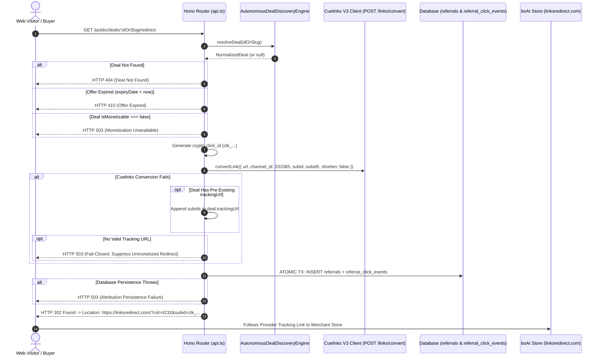

# V4.9 Attribution, Link Conversion & Public Redirect Architecture

**Repository:** `harshavardhankotu/ai-marketing-organization`  
**Working Branch:** `feat/v4-2-multi-sector-commerce-recovery` (PR #34)  
**Production Endpoint:** `GET /public/deals/:id/redirect`  
**Affiliate Provider:** Cuelinks India V3 Publisher API  
**Publisher Channel ID:** `331585`  
**Target Campaign ID:** `4232` (boAt Lifestyle Store)  
**Date:** November 3, 2026  

---

## 1. Architecture Overview

In affiliate commerce, attribution integrity is the absolute bridge between a customer click and bank payout. If a single element in the redirection pipeline fails—whether through parameter stripping, asynchronous race conditions, or unmonetized fallbacks—the commercial loop collapses to ₹0.00.

In Sprint V4.9, the entire public deal redirect pipeline was overhauled to guarantee:
1. **Dynamic Visitor-Specific Conversion:** Every visitor click converts the merchant product URL on demand with a unique, cryptographically strong click ID.
2. **5-Level Sub-ID Hierarchy:** Full commercial context is injected into provider tracking parameters (`subid` through `subid5`).
3. **Atomic Attribution Persistence:** Local database records (`referrals` and `referral_click_events`) are committed inside an atomic transaction BEFORE the HTTP 302 redirect header is emitted.
4. **Strict Fail-Closed Enforcement:** Zero raw URL fallbacks. If conversion or database persistence fails, an HTTP 503 is returned to protect attribution integrity.
5. **No State Mutation on GET:** Public GET endpoints are strictly idempotent and read-only with respect to administrative business entities (`partners`, `partner_offers`).

---

## 2. Dynamic Sub-ID Hierarchy Specification

Cuelinks V3 supports up to 5 sub-identity parameters. V4.9 enforces a rigid, standardized semantic taxonomy across all 5 levels:

| Parameter | Type / Format | Purpose | Example Value |
|---|---|---|---|
| `subid` | `clk_<timestamp>_<uuid16>` | Primary Click Identifier. Matched 1-to-1 against `referrals.click_id` during transaction reconciliation. | `clk_1793668758606_499c86f4a1b2c3d4` |
| `subid2` | `SECTOR_<A-H>_<NAME>` | Commercial Sector Code from the 8-sector taxonomy. Used for sector ROI and conversion rate analytics. | `SECTOR_B_ELECTRONICS` |
| `subid3` | `string` (Numeric / String) | Provider Affiliate Campaign ID. Correlates clicks to upstream merchant terms and commissions. | `4232` (boAt Lifestyle) |
| `subid4` | `string` (Slug / SKU) | Canonical Deal Slug or SKU. Identifies the exact product offer that drove the conversion. | `boat-airdopes-141-anc` |
| `subid5` | `string` | Traffic Placement Source. Distinguishes channel origin (organic deal card, buying guide, newsletter). | `deal_redirect` |

---

## 3. Redirect Execution Flow & Code Path



---

## 4. Key Implementation Artifacts

### 4.1 Link Conversion in `cuelinks-v3-client.ts`
```typescript
// Bounded payload with subid 1-5 and explicit shorten control
const payload: Record<string, any> = {
  url: destinationUrl,
  shorten: request.shorten !== undefined ? Boolean(request.shorten) : true
};

if (request.channel_id) payload.channel_id = request.channel_id;
if (request.subid) payload.subid = String(request.subid).substring(0, 50);
if (request.subid2) payload.subid2 = String(request.subid2).substring(0, 50);
if (request.subid3) payload.subid3 = String(request.subid3).substring(0, 50);
if (request.subid4) payload.subid4 = String(request.subid4).substring(0, 50);
if (request.subid5) payload.subid5 = String(request.subid5).substring(0, 50);

const res = await this.request('/links/convert', { method: 'POST', body: payload });
```

### 4.2 Traffic Classification in `referral-tracking.ts`
Public traffic is strictly evaluated before telemetry writes:
- Automated crawlers, health-check monitors, and diagnostic pings are classified as `'bot'` or `'diagnostic'`.
- Standard browser user-agents without interactive client verification are classified as `'browser_candidate'`.
- Verified human telemetry is reserved exclusively for interactive buyer sessions.
- Bots and non-human traffic never mutate deal click counts or generate attribution records.

### 4.3 Atomic Persistence & Fail-Closed Guard in `routes/api.ts`
```typescript
if (!targetUrl) {
  return c.text('Affiliate monetization path temporarily unavailable for this deal; unmonetized fallback suppressed', 503);
}

try {
  if (isProduction()) {
    await d1Repo.executeWrite('referrals', insertRefSql, refParams);
    await d1Repo.executeWrite('referral_click_events', insertClickSql, clickParams);
  } else {
    const insertTx = db.transaction(() => {
      db.prepare(insertRefSql).run(...refParams);
      db.prepare(insertClickSql).run(...clickParams);
    });
    insertTx();
  }
} catch (dbErr: any) {
  console.error(`[DealRedirect] Critical database error persisting click attribution: ${dbErr.message}`);
  return c.text('Attribution persistence failure; redirect suppressed to prevent untracked referral', 503);
}

return c.redirect(targetUrl, 302);
```

---

## 5. Automated Verification Proof

The redirect safety and attribution pipeline is verified under automated tests in `v4-9-first-sale-conversion-integrity.test.ts`:
- **Phase 2 & 3 Unit Tests:**
  - `strictly separates full tracking_url from short_url in convertLink response` (PASS)
  - `fails closed when Cuelinks returns affiliated: false or invalid domain` (PASS)
  - `classifies browser user-agent as browser_candidate and never confirmed human` (PASS)
  - `classifies bots accurately without attributing clicks` (PASS)
  - `issues HTTP 302 to provider tracking URL and persists referral and click events atomically` (PASS)
  - `returns HTTP 503 and suppresses redirect when link conversion is unavailable` (PASS)
